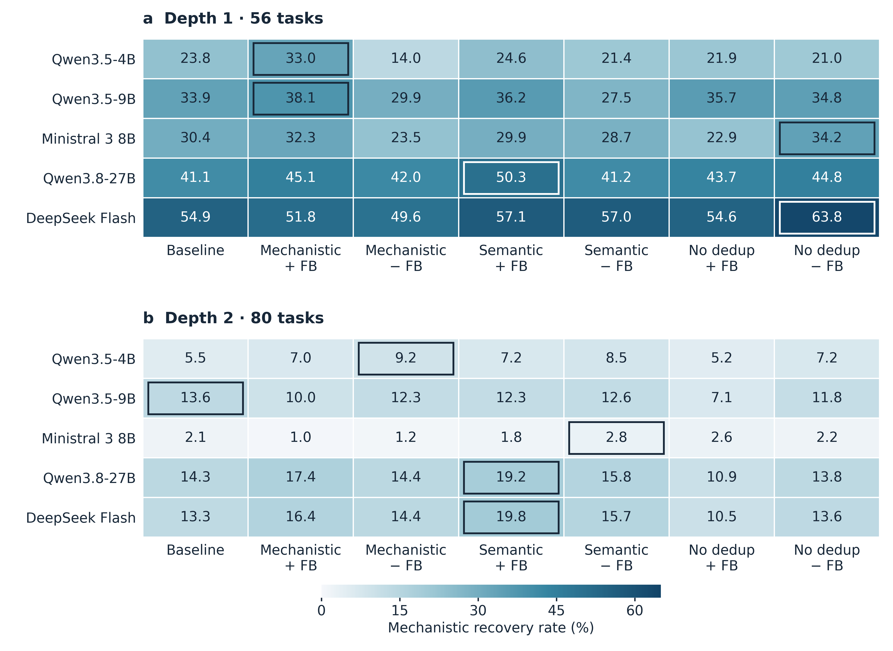

# 大语言模型的布尔假设恢复实验

给定少量输入输出观测，大语言模型能找回多少种符合观测的布尔表达式？本项目基于 HypoSpace 的布尔任务，在相同的模型调用预算下，比较独立采样、去重和反馈对表达式覆盖率的影响。

例如，只知道 `x = 1`、`y = 1` 时输出为 `1`，`x and y` 和 `x or y` 都符合这一条观测。题集枚举了符合观测的表达式，评测检查模型能找回其中多少种结构。

## 结果速览

在 80 道困难题的存档实验中，语义去重加反馈提高了 DeepSeek Flash 和 Qwen3.8-27B 的机制恢复率。两款模型在这一配置下恢复的复杂真值仍然有限。其他模型的最高分出现在不同配置中。[综合实验报告](our_method/results/paper_analysis/REPORT.md)

| 模型 | 独立基线 RR | 语义去重＋反馈 RR | 该配置恢复的复杂真值 |
| --- | ---: | ---: | ---: |
| DeepSeek Flash | 13.30% | 19.83% | 13 / 300 |
| Qwen3.8-27B | 14.26% | 19.15% | 0 / 300 |

RR 是逐题机制恢复率的等权平均。复杂真值一列按「题目与机制」配对计数。同一模型的配置对照更适合用来判断去重和反馈的效果，跨模型结果还受到提示版本、推理后端和输出上限的影响。[逐组指标](our_method/results/paper_analysis/summary_metrics.csv) · [逐题配对差值](our_method/results/paper_analysis/paired_effects.csv)



## 快速开始

推荐使用 Python 3.12 或更新版本。从仓库根目录进入 `our_method/`，创建虚拟环境并安装依赖。

```bash
cd our_method
python -m venv .venv
source .venv/bin/activate
python -m pip install -r requirements.txt
```

Windows PowerShell 使用 `.\.venv\Scripts\Activate.ps1` 激活环境。后续命令均从 `our_method/` 运行。

### 离线演示

`--mock` 使用模拟回复，无需推理服务或 API 密钥。下面的命令让两种方法评测相同的 3 道题并生成对比图。演示结果用于验证运行流程。

```bash
python baseline.py --mock --samples 3 --seed 42 --output outputs/demo/baseline.csv --resume
python evaluate_ours.py --mock --samples 3 --seed 42 --output outputs/demo/ours.csv --resume
python compare_results.py --baseline outputs/demo/baseline.csv --ours outputs/demo/ours.csv --summary outputs/demo/summary.csv --chart outputs/demo/recovery.png
python -m unittest discover
```

| 输出 | 内容 |
| --- | --- |
| `outputs/demo/baseline.csv`、`outputs/demo/ours.csv` | 每题的调用次数、指标、候选式和模型原始回复 |
| `outputs/demo/summary.csv` | 两组方法的平均指标 |
| `outputs/demo/recovery.png` | 有效率、新颖率、总体及分层恢复率和平均调用次数 |

## 实验设计

| 题集 | 题数 | 最大深度 | 每组完整评测的默认调用数 |
| --- | ---: | ---: | ---: |
| Basic | 35 | 1 | 60 |
| Extended（默认，报告中的普通题） | 56 | 1 | 90 |
| Full（困难题） | 80 | 2 | 975 |

每题的默认调用次数等于该题的机制真值数，无效回复和重复回复都计入预算。模型每次只提交一个候选式，评分器检查允许的变量、算子、深度和全部观测。[题集格式与生成方法](our_method/data/README.md) · [评分代码](our_method/benchmark_utils.py)

综合实验比较七组配置，包括独立采样基线和三种去重规则分别开启与关闭反馈的六组组合。

- **机制去重（`mechanistic`）**按题集定义的表达式结构比较，例如交换 `and` 的操作数视为同一机制。
- **语义去重（`semantic`）**按完整真值表比较，例如 `x` 和 `x or (x and y)` 视为等价。
- **无去重（`none`）**允许重复候选。

开启反馈时，后续提示可展示已接受的表达式和最近的拒绝原因。

| 指标 | 逐题计算方式 |
| --- | --- |
| 有效率（VR） | 满足表达式约束和全部观测的候选数 ÷ 调用次数 |
| 新颖率（NR） | 假设空间内不同机制的候选数 ÷ 调用次数，包括结构合法但与观测不符的候选 |
| 机制恢复率（RR） | 找回的不同机制真值数 ÷ 该题的机制真值总数 |

汇总时，每道题权重相同。报告还给出按真值表匹配的语义 RR，以及按题集原始公式中运算符数量划分的简单解 RR（0–3 个）和复杂解 RR（4 个以上）。普通题没有复杂真值，复杂解 RR 显示为 `n/a`。[完整评分口径](our_method/results/paper_analysis/REPORT.md#1-评分与比较口径)

## 使用真实模型

启动 OpenAI 兼容的推理服务，将 `LLM_MODEL` 设为服务返回的模型 ID。服务要求鉴权时，在本地设置 `LLM_API_KEY`。下面两组命令均使用默认普通题集。

```bash
export LLM_BASE_URL=http://127.0.0.1:8080/v1
export LLM_MODEL=your-model-id
python baseline.py --samples 56 --seed 42 --output outputs/real/baseline.csv
python evaluate_ours.py --samples 56 --seed 42 --output outputs/real/ours.csv
python compare_results.py --baseline outputs/real/baseline.csv --ours outputs/real/ours.csv --summary outputs/real/summary.csv --chart outputs/real/recovery.png
```

PowerShell 使用 `$env:LLM_BASE_URL = "http://127.0.0.1:8080/v1"` 和 `$env:LLM_MODEL = "your-model-id"` 设置端点和模型。

| 操作 | 参数 |
| --- | --- |
| 改用困难题 | 两组均加 `--dataset data/boolean_full_depth2.json`，将 `--samples` 改为 `80` |
| 切换去重规则 | 在 `evaluate_ours.py` 上加 `--dedup semantic` 或 `--dedup none`，默认按机制去重 |
| 关闭反馈 | 在 `evaluate_ours.py` 上加 `--no-feedback` |
| 限制每题调用数 | 两组均加相同的 `--max-attempts`，例如 `--max-attempts 2` |
| 续跑中断的实验 | 保持原参数和输出路径，加 `--resume` |

成对比较时使用相同模型、题集、题目种子、温度和逐题预算。若改变题集或配置，为各组指定新的输出路径。`--seed` 控制题目抽样与顺序，模型输出的随机性由推理端配置决定。[扩展实验与其他模型后端](our_method/README.md)

## 离线复算已有结果

用仓库已保存的逐题记录和日志，可直接离线重建综合报告所用的统计表与图表。下载仓库 ZIP 后也可运行。

```bash
python results/paper_analysis/reproduce.py
```

成功运行时应看到 `Verified 6720 task rows across 105 CSV groups.`。脚本在 `results/paper_analysis/` 中重新生成四张统计表和五张图，每张图提供 PNG 和 PDF 两种格式。报告记录了模型配置、配对比较、重复实验和解码约束。[综合实验报告](our_method/results/paper_analysis/REPORT.md) · [复算脚本](our_method/results/paper_analysis/reproduce.py)

## 仓库结构

```text
our_method/
├── baseline.py / evaluate_ours.py / compare_results.py   运行评测和绘图
├── benchmark_cli.py / benchmark_utils.py                公共评测流程和评分
├── boolean_genetics.py                                 表达式校验、去重和采样
├── llm_caller.py / mock_llm.py                          模型接口和离线模拟
├── data/                                               三套布尔题集
├── experiments/                                        七组对照、深度约束和早期实验
├── results/                                            原始记录、实验报告和复算脚本
└── tests/                                              单元测试
references/
├── hypospace/                                           HypoSpace 参考代码
└── HypoSpace-ICML-2026.pdf                               参考论文
```

## 引用

本项目的布尔题集与评估任务基于 Chen 等人的 ICML 2026 论文 *HypoSpace: A Diagnostic Benchmark for Set-Valued Hypothesis Generation under Underdetermination and Sublinear Coverage Bounds*。[论文与引用信息](https://proceedings.mlr.press/v306/chen26bz.html) · [HypoSpace 上游代码](https://github.com/CTT-Pavilion/_HypoSpace)
