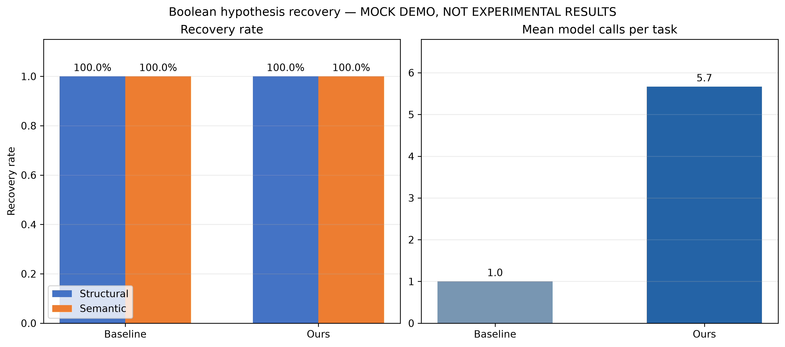

# Boolean Genetics: Inference-Time Sampling

This project compares a one-shot Boolean-expression baseline with memory-based
rejection sampling. The sampler validates each candidate against observations,
rejects duplicates by truth-table equivalence, feeds rejection reasons into
later prompts, and reduces temperature as it approaches the target.

## Setup

Run the following commands from the `our_method` directory:

```powershell
Set-Location .\our_method
python -m venv .venv
.\.venv\Scripts\Activate.ps1
python -m pip install -r requirements.txt
```

The official dataset generator requires NumPy and SymPy:

```powershell
python ..\_HypoSpace-main\boolean\boolean_dataset.py --operators extended --max-depth 1 --seed 42 --output data\boolean_dataset.json
```

AINative can provision a temporary API key on the first real request; no
account setup is needed. The SDK saves that key in
`~/.ainative/config.json` and prints a claim URL for permanent access. Prompts
and benchmark observations are sent to AINative's API:

```powershell
$env:AINATIVE_MODEL = "gpt-oss-120b"
```

The default model is `gpt-oss-120b`, which was verified with the automatically
provisioned Basic-tier key. The suggested
`meta-llama/Llama-3.3-70B-Instruct` currently returns HTTP 403 on that tier;
it requires a plan upgrade. Set `AINATIVE_MODEL` to override the default. The
SDK retries transient API errors up to three times.

For an OpenAI-compatible endpoint such as OVHcloud's, configure the endpoint
and model:

```powershell
$env:LLM_BASE_URL = "https://oai.endpoints.kepler.ai.cloud.ovh.net/v1"
$env:AINATIVE_MODEL = "gpt-oss-120b"
python baseline.py --samples 1 --seed 42
python evaluate_ours.py --samples 1 --seed 42 --max-attempts 3
```

When `LLM_BASE_URL` is set, the client uses `LLM_API_KEY` if provided, or the
`not-needed` placeholder by default; it does not send an AINative key to the
custom endpoint. For OVHcloud's anonymous host, the client explicitly omits
the `Authorization` header. Anonymous access depends on the provider's current
policy; a 403 response may mean that endpoint access requires authentication.
For Hugging Face, set `LLM_BASE_URL` to
`https://router.huggingface.co/v1`, `LLM_MODEL` to a provider-supported model
ID, and `LLM_API_KEY` in your local environment.

For OpenRouter, set your API key as an environment variable. The adapter will
automatically use OpenRouter's OpenAI-compatible endpoint and the `openrouter/free`
model router; set `LLM_MODEL` if you want to choose a specific model instead:

```powershell
$env:OPENROUTER_API_KEY = "your-openrouter-api-key"
$env:LLM_MODEL = "openrouter/free"
python baseline.py --samples 1 --seed 42
```

## Run

### Offline mock (no API key or network request)

The deterministic mock intentionally returns malformed text, an inconsistent
Markdown-fenced expression, a labeled answer, and a duplicate before returning
valid candidates. This exercises the parser, rejection loop, CSV writing, and
plotting pipeline. These outputs are synthetic and are **not experimental
evidence**:

```powershell
python baseline.py --mock --samples 3 --seed 42
python evaluate_ours.py --mock --samples 3 --seed 42 --max-attempts 20
python compare_results.py --baseline results\baseline_mock.csv --ours results\ours_mock.csv --summary results\summary_mock.csv --chart results\recovery_mock.png
```



### Real model

Run both experiments with the same model, seed, and dataset so their sampled
tasks match:

```powershell
python baseline.py --samples 10 --seed 42
python evaluate_ours.py --samples 10 --seed 42 --max-attempts 50
python compare_results.py
```

If either run is interrupted, rerun the same command with the same
`--samples`, `--seed`, and `--output`, adding `--resume` to skip tasks already
saved in that CSV. Each completed task is flushed and synced to disk before the
next one begins.

Outputs are written under `results\`. Recovery is reported using the official
structural (mechanistic-key) criterion and also using semantic truth-table
equivalence. The two metrics have different denominators, so they should not
be conflated. Each completed task is appended to its CSV immediately, so
completed results remain available if a run is interrupted. Re-running with
the same output path appends rows rather than replacing the previous run.

For AINative, the adapter reads `AINATIVE_MODEL`; set `AINATIVE_API_KEY` to
avoid automatic provisioning. For OpenRouter, `OPENROUTER_API_KEY` selects the
provider and `LLM_MODEL` overrides its default model.

## Limitations

- Rejection sampling can require substantially more model calls than one-shot
  generation, increasing latency and API usage.
- Output extraction handles common labels and Markdown fences, but other
  malformed or novel response formats may still be rejected.
- Truth-table semantic deduplication is exponential and supports at most 16
  variables.
- Mock mode only validates software behavior; only real model runs can support
  conclusions about hypothesis recovery.

Run the 13 local tests with `python -m unittest discover`. They cover
expression validation, semantic deduplication, malformed mock outputs, API
retry handling, and recovery metrics.
