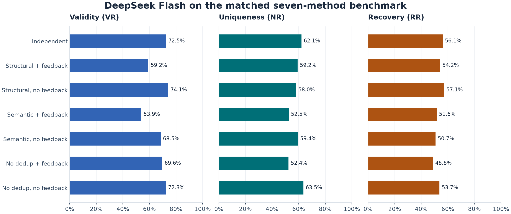
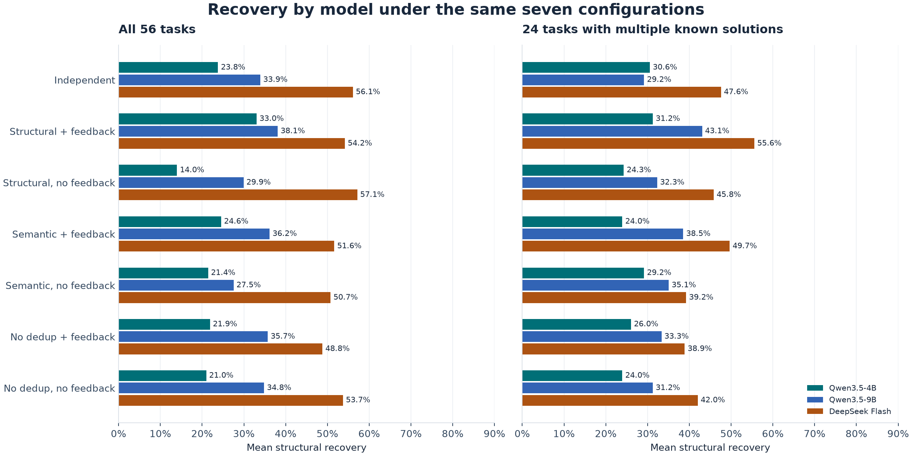

# DeepSeek Flash 七组同口径实验

本实验使用与 Qwen3.5-4B 和 9B 相同的 56 道 Boolean 题、七组配置和逐题候选预算。DeepSeek 各组重新独立生成一次，每组记录 90 个候选，共 630 个。

## DeepSeek 汇总

| 配置 | VR | NR | RR | RR 相对 baseline（百分点） | 候选数 |
|---|---:|---:|---:|---:|---:|
| 独立多轮 baseline | 72.47% | 62.05% | 56.10% | +0.00 | 90 |
| 结构去重 + 反馈 | 59.23% | 59.23% | 54.17% | -1.93 | 90 |
| 结构去重 + 无反馈 | 74.11% | 58.04% | 57.14% | +1.04 | 90 |
| 真值表去重 + 反馈 | 53.87% | 52.53% | 51.64% | -4.46 | 90 |
| 真值表去重 + 无反馈 | 68.45% | 59.38% | 50.74% | -5.36 | 90 |
| 不去重 + 反馈 | 69.64% | 52.38% | 48.81% | -7.29 | 90 |
| 不去重 + 无反馈 | 72.32% | 63.54% | 53.72% | -2.38 | 90 |

本次一轮中，整体 RR 最高的是结构去重 + 无反馈（57.14%）。结构去重加普通反馈相对独立多轮的 RR 差值，全部 56 题为 -1.93 个百分点，24 道多解题为 +7.99 个百分点。

## 跨模型比较

| 模型 | 独立多轮 RR | 结构去重加反馈 RR | 多解题独立多轮 RR | 多解题结构去重加反馈 RR |
|---|---:|---:|---:|---:|
| Qwen3.5-4B | 23.81% | 33.04% | 30.56% | 31.25% |
| Qwen3.5-9B | 33.93% | 38.10% | 29.17% | 43.06% |
| DeepSeek Flash | 56.10% | 54.17% | 47.57% | 55.56% |

## 两套实验的关系

这里的七组由独立多轮 baseline 加上三种去重方式与反馈开关的六种组合构成。无去重且无反馈与独立多轮 baseline 采用相同的生成设置，两组分别独立运行。此处关闭反馈会同时隐藏已接受答案历史和拒绝原因。此前 DeepSeek 的五组困难题实验专门检验历史、普通拒绝提示和具体反例各自的作用，独立多轮和结构去重加普通反馈是两套设计共同的配置。

两款本地 Qwen 和 DeepSeek 都关闭思考模式，温度为 0.7。DeepSeek 使用云端 API、64 tokens 输出上限并并行处理独立题目。Qwen 使用本地 llama.cpp。每组只有一轮，分数用于描述本次模型表现，跨后端墙钟耗时未直接比较。

[逐组汇总](summary.csv) · [分层汇总](strata.csv) · [三模型对比数据](comparison_with_qwen.csv) · [运行配置和实际用量](manifest.json)
