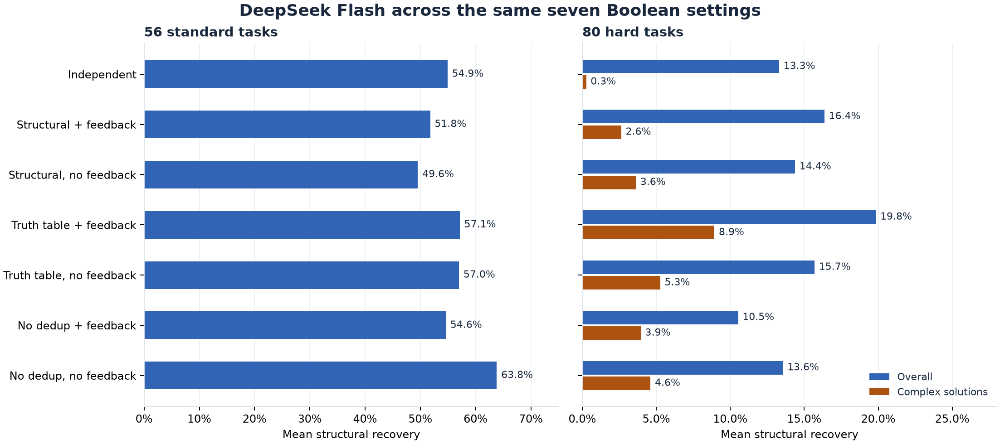

# DeepSeek 困难题七组对照

80 道题使用团队提交的困难数据集、新版提示词和评分器。设置与普通题的七组一致，每组一轮，每组 975 个候选。baseline 与结构去重加普通反馈复用前一轮新版运行，另外五组重新调用 API。

| 配置 | 普通题 RR | 困难题 VR | 困难题 RR | 复杂解 RR | 超深率 |
|---|---:|---:|---:|---:|---:|
| 独立多轮 baseline | 54.91% | 67.55% | 13.30% | 0.26% | 1.74% |
| 结构去重 + 反馈 | 51.79% | 54.46% | 16.36% | 2.63% | 13.13% |
| 结构去重 + 无反馈 | 49.55% | 66.05% | 14.37% | 3.62% | 5.44% |
| 真值表去重 + 反馈 | 57.14% | 52.05% | 19.83% | 8.93% | 14.05% |
| 真值表去重 + 无反馈 | 56.99% | 66.94% | 15.69% | 5.26% | 2.97% |
| 不去重 + 反馈 | 54.61% | 80.62% | 10.53% | 3.95% | 0.82% |
| 不去重 + 无反馈 | 63.84% | 68.25% | 13.55% | 4.61% | 1.74% |

本轮困难题整体覆盖率最高的是真值表去重 + 反馈（19.83%），复杂解覆盖率最高的是真值表去重 + 反馈（8.93%）。
独立多轮 baseline 和不去重且无反馈使用相同生成设置，两组独立抽样。各组单轮分数会受生成波动影响。

[七组汇总](summary.csv) · [配置与用量](manifest.json)
