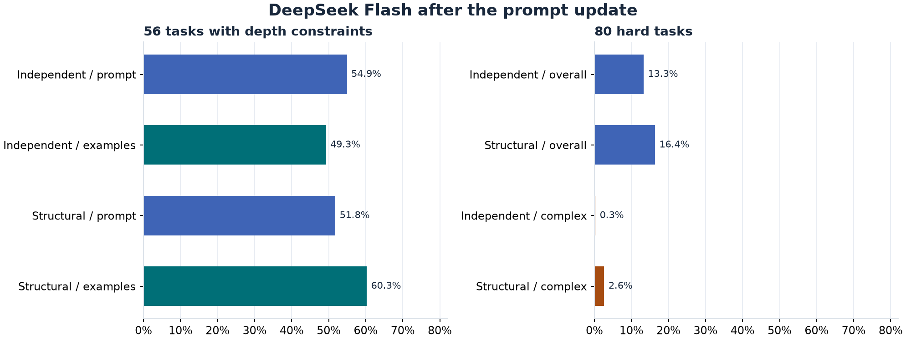
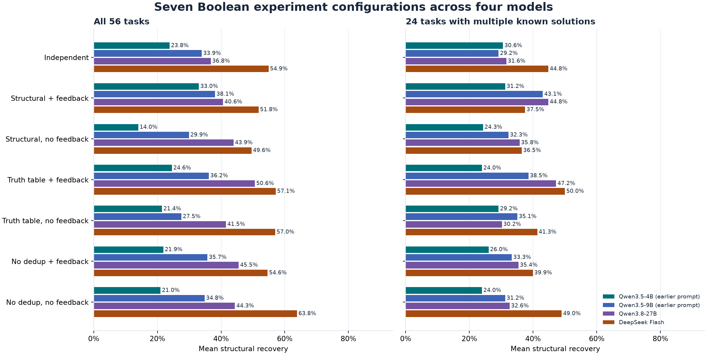

# DeepSeek Flash 新版团队对照

使用团队仓库当前提示词、评分器和数据集。56 题七组各用 90 个候选，另跑两个深度示例组，80 道困难题跑文档里的 baseline 和结构去重各 975 个候选。每组一轮，逐题按机制真值数量分配预算。

## DeepSeek 结果

| 数据集 | 方法 | 条件 | 候选数 | VR | NR | RR | 复杂解 RR | 超深率 |
|---|---|---|---:|---:|---:|---:|---:|---:|
| easy | Independent | prompt | 90 | 69.94% | 60.86% | 54.91% | n/a | 20.00% |
| easy | Structural + feedback | prompt | 90 | 63.10% | 59.82% | 51.79% | n/a | 27.78% |
| easy | Structural, no feedback | prompt | 90 | 63.24% | 52.53% | 49.55% | n/a | 31.11% |
| easy | Truth table + feedback | prompt | 90 | 58.93% | 65.77% | 57.14% | n/a | 36.67% |
| easy | Truth table, no feedback | prompt | 90 | 69.05% | 60.57% | 56.99% | n/a | 26.67% |
| easy | No dedup + feedback | prompt | 90 | 73.81% | 62.35% | 54.61% | n/a | 15.56% |
| easy | No dedup, no feedback | prompt | 90 | 79.61% | 68.01% | 63.84% | n/a | 14.44% |
| easy | Independent | examples | 90 | 68.15% | 56.10% | 49.26% | n/a | 18.89% |
| easy | Structural + feedback | examples | 90 | 71.43% | 65.33% | 60.27% | n/a | 23.33% |
| hard | Independent | prompt | 975 | 67.55% | 23.29% | 13.30% | 0.26% | 1.74% |
| hard | Structural + feedback | prompt | 975 | 54.46% | 29.08% | 16.36% | 2.63% | 13.13% |

## 跨模型比较

Qwen3.8-27B 与这批 DeepSeek 的采样器哈希相同。27B 的输出上限为 256 tokens，DeepSeek 为 128 tokens。Qwen3.5-4B 和 9B 原始七组来自早于新版提示词的提交，图中标注 earlier prompt。两款本地 Qwen 的深度对照使用 llama.cpp 的生成种子与 GBNF；DeepSeek 官方 Chat Completions 接口不提供等价设置，语法两组在对比表中留空。

[逐组汇总](summary.csv) · [七组跨模型表](cross_model_seven_groups.csv) · [深度约束对照表](cross_model_depth_constraints.csv) · [配置和用量](manifest.json)

[普通题逐题记录](easy/raw/)包含分数、原始回复、请求用量及深度诊断。困难题的[基线](../deepseek_flash_hard_seven_20261126/raw/baseline_prompt.csv)和[机制去重加反馈](../deepseek_flash_hard_seven_20261126/raw/ours_mechanistic_prompt.csv)记录由困难题七组实验共用。
