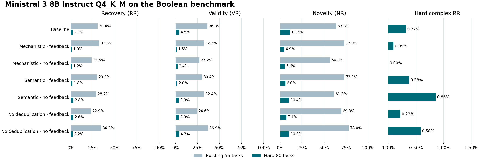

# Ministral 3 8B Instruct Q4_K_M 布尔假设恢复实验

56 题数据来自[此前的七组实验](https://github.com/jinghe-yu/machine_learning_project/blob/ace7fbe/our_method/results/ministral3_8b_instruct_2512_q4_k_m_20261126/REPORT.md)，补跑使用 80 道困难题。

## 困难题补跑

七组均覆盖[困难题集](../../data/boolean_full_depth2.json)的 80 个观测集，每组计入 975 次调用。每题预算等于机制真值数量。RR、VR、NR 逐题平均。复杂解 RR 在包含 4–5 个运算符真值的 76 题上逐题平均。

| 配置 | 现有 56 题 RR | 困难题 RR | 困难题复杂解 RR | 困难题 VR | 困难题 NR | 困难题 RR 相对 Baseline（百分点） |
|---|---:|---:|---:|---:|---:|---:|
| [Baseline](hard/raw/baseline.csv) | 30.36% | 2.06% | 0.32% | 4.47% | 11.29% | +0.00 |
| [机制去重 · 有反馈](hard/raw/ours_mechanistic.csv) | 32.29% | 0.99% | 0.09% | 1.54% | 4.86% | -1.07 |
| [机制去重 · 无反馈](hard/raw/ours_mechanistic_no_feedback.csv) | 23.51% | 1.20% | 0.00% | 2.40% | 5.55% | -0.86 |
| [语义去重 · 有反馈](hard/raw/ours_semantic.csv) | 29.91% | 1.85% | 0.38% | 1.99% | 5.99% | -0.22 |
| [语义去重 · 无反馈](hard/raw/ours_semantic_no_feedback.csv) | 28.72% | 2.79% | 0.86% | 3.94% | 10.38% | +0.73 |
| [无去重 · 有反馈](hard/raw/ours_none.csv) | 22.92% | 2.62% | 0.22% | 3.94% | 7.08% | +0.55 |
| [无去重 · 无反馈](hard/raw/ours_none_no_feedback.csv) | 34.23% | 2.19% | 0.58% | 4.30% | 10.34% | +0.13 |

- 困难题 RR 最高的是 **语义去重 · 无反馈（2.79%）**。复杂解 RR 最高的配置为 语义去重 · 无反馈（0.86%）。
- 默认机制去重有反馈的 RR 为 0.99%，相对 Baseline -1.07 个百分点。逐题比较中，3 题提高、61 题持平、16 题下降。复杂解 RR 从 0.32% 变为 0.09%。

| 去重规则 | 有反馈 − 无反馈，困难题 RR（百分点） | 有反馈 − 无反馈，困难题复杂解 RR（百分点） |
|---|---:|---:|
| 机制 | -0.21 | +0.09 |
| 语义 | -0.95 | -0.48 |
| 无 | +0.43 | -0.37 |

### 输出格式诊断

七组合计 6,825 个候选中，5,935 个被当前评分器判为语法错误。4,488 个无效候选的首尾带有 Markdown 行内反引号，例如 `` `NOR(x, y)` ``。对已生成的候选作离线检查，仅去掉首尾反引号后有 656 个同时满足表达式约束和题目观测。表中的分数仍按原始评估流程计算。

本次使用 M2 Pro、llama.cpp b12359 Metal、Thinking 关闭，温度 0.7，每个请求最多 128 个输出 token。题目间使用 16 个并发槽，每槽有效上下文为 1536，同题的反馈轮次顺序执行。按方法、题目和轮次固定生成种子，每组执行一次。达到输出上限的回复有 0 条，按原样计分。56 题历史结果与本次使用的题集、提示版本和推理配置有差异，表中并列提供两轮成绩。

[困难题汇总 CSV](hard/summary.csv) · [按观测数和真值数分层](hard/strata.csv) · [运行配置](hard/manifest.json) · [运行日志](hard/logs/runs.jsonl)
