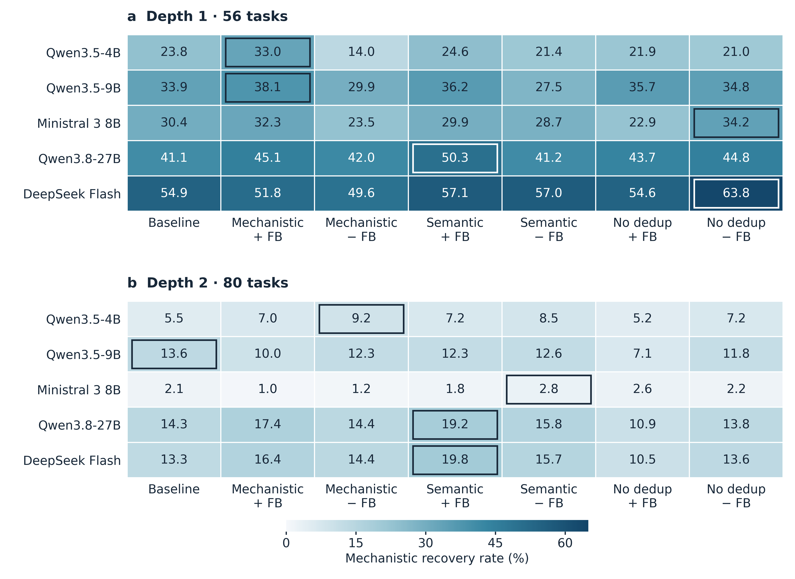
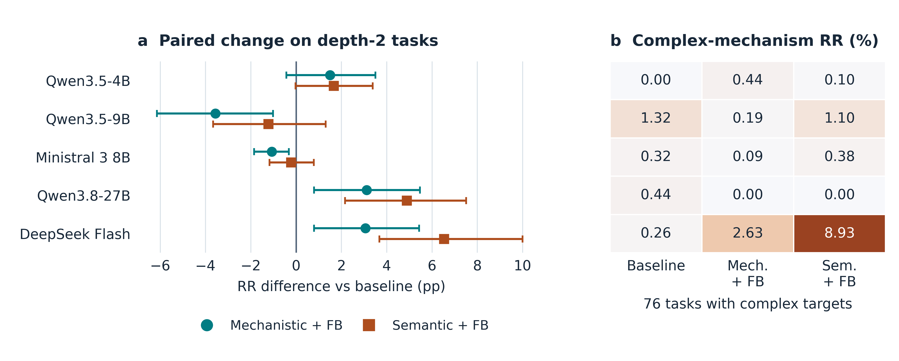
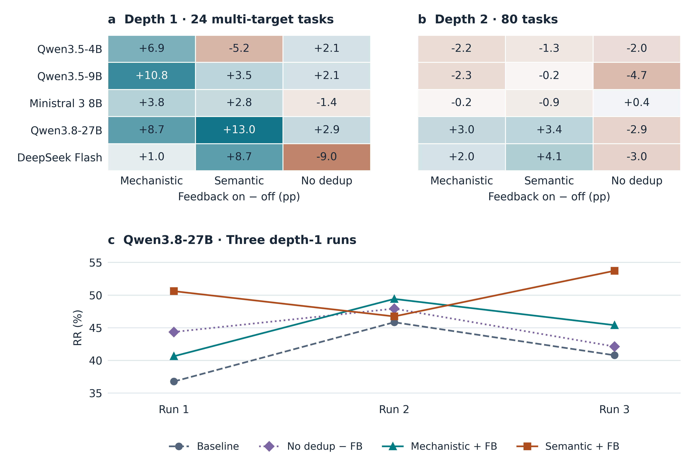
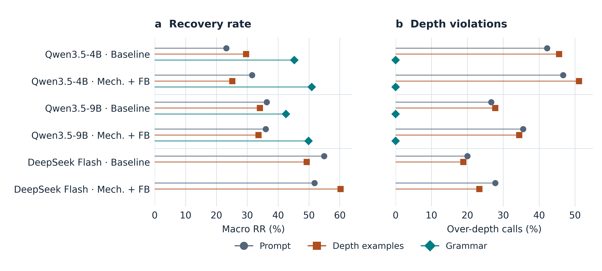
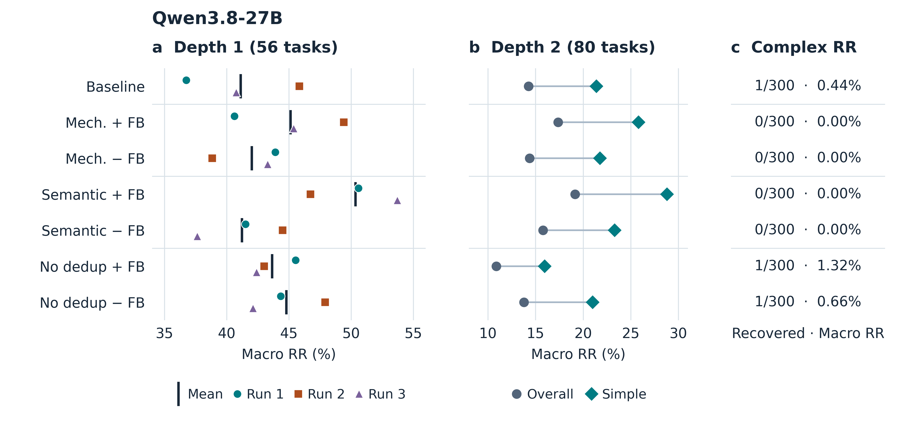

# 布尔假设恢复实验综合分析

**语义去重加反馈在两款模型的困难题上提高了整体恢复率，复杂机制的恢复仍然是主要瓶颈。** 在 80 道深度 2 题上，DeepSeek Flash 的机制恢复率从 13.30% 升至 19.83%（+6.54 个百分点），Qwen3.8-27B 从 14.26% 升至 19.15%（+4.89 个百分点）。前者恢复了 300 个复杂真值中的 13 个，后者恢复了 0 个。三款小型量化模型的最高分分别出现在机制去重无反馈、基线、语义去重无反馈三种配置中。另一个 56 题配对实验中，语法约束在 Qwen3.5-4B 和 9B 的四个对照组中均提高了恢复率。

## 1. 评分与比较口径

| 题集 | 题数 | 每组调用 | 机制数／语义类别数 | 运算符 | 多真值题 |
| --- | ---: | ---: | ---: | --- | ---: |
| 普通题，深度上限 1 | 56 | 90 | 6／6 | NOT、AND、OR | 24 |
| 困难题，深度上限 2 | 80 | 975 | 65／16 | NOT、AND、OR、NOR | 78 |

每题调用次数等于该题的机制真值数。重复、无效和被拒绝的提案均占用调用预算。**机制恢复率（RR）** 的分子是恢复到的不同机制真值数，分母是该题的机制真值数。**有效率（VR）** 统计符合语法、表达式约束与全部观测的提案比例。**新颖率（NR）** 统计假设空间内不同机制的数量除以调用数，其中可以包含结构合法但与观测不符的候选。**语义 RR** 按完整真值表匹配。以上指标均先按题计算，再对题目等权平均。复杂 RR 在 76 道含复杂真值的困难题上计算，按数据集原始公式计数，简单机制含 0–3 个运算符，复杂机制含 4–5 个。困难题共有 675 个简单真值和 300 个复杂真值，此处的计数单位为题目与机制的配对。 [评分代码](../../benchmark_utils.py) · [困难题集说明](../../data/README.md)

七组结果涵盖独立采样基线，以及三种去重规则与反馈开关的六种组合。开启反馈后，提示可展示已接受的候选和最近的拒绝原因。基线与「无去重 − 反馈」使用同一生成规则并独立采样。配对按 `observation_set_id` 对齐，先计算同题 RR 差值，再按题等权平均。图 2 的区间按观测条数分层，在每层对配对题目有放回重采样 20,000 次，取第 2.5 与 97.5 百分位。区间反映已保存运行中的题目差异。题目共享布尔假设空间，区间没有纳入解码重复、跨模型配置差异或多重比较。 [逐题配对统计](paired_effects.csv)

主图采用 DeepSeek 新版提示结果。Qwen3.8-27B 普通题取三次运行的均值，困难题为单次运行，其余主图单元格均为单次。Ministral 普通题使用从 Git 提交 `ace7fbe` 恢复的[逐题记录](../ministral3_8b_instruct_2512_q4_k_m_20261126/raw/)。DeepSeek 困难题七组实验沿用了新版提示实验的基线和机制去重加反馈记录，两个组各计一次。所有主图配置均核对了题号、观测数、真值数及逐题预算。 [DeepSeek 困难题运行清单](../deepseek_flash_hard_seven_20261126/manifest.json) · [27B 重复协议](../qwen38_27b_nvfp4_20261126_repeats/repeat_protocol.json)

## 2. 跨模型与题集表现

下表的百分数为机制 RR，带正负号的列为同模型、同题集内「机制去重＋反馈」相对基线的绝对差。

| 模型 | 普通题基线 | 普通题最高配置 | 默认差值（百分点） | 困难题基线 | 困难题最高配置 | 默认差值（百分点） |
| --- | ---: | --- | ---: | ---: | --- | ---: |
| Qwen3.5-4B | 23.81% | 机制＋反馈 33.04% | +9.23 | 5.50% | 机制 − 反馈 9.18% | +1.50 |
| Qwen3.5-9B | 33.93% | 机制＋反馈 38.10% | +4.17 | 13.56% | 基线 13.56% | −3.56 |
| Ministral 3 8B | 30.36% | 无去重 − 反馈 34.23% | +1.93 | 2.06% | 语义 − 反馈 2.79% | −1.07 |
| Qwen3.8-27B | 41.12% | 语义＋反馈 50.35% | +4.02 | 14.26% | 语义＋反馈 19.15% | +3.12 |
| DeepSeek Flash | 54.91% | 无去重 − 反馈 63.84% | −3.12 | 13.30% | 语义＋反馈 19.83% | +3.06 |

五个模型在困难题上的基线 RR 均低于普通题，降幅为 18.31–41.61 个百分点。两套题的运算符、假设空间与逐题预算同时变化。普通题和困难题还涉及提示版本差异，本地 4B、9B 和 Ministral 的困难题使用 16 槽 llama.cpp，27B 使用 vLLM，DeepSeek 使用云端 API。模型比较反映各自已记录的部署配置及其在题集上的表现。DeepSeek 与 27B 的困难题最高 RR 相差 0.68 个百分点，解码重复不足以估计这项排名的稳定性。 [本地困难题总表](../local_models_hard_comparison.csv) · [27B 困难题配置](../qwen38_27b_nvfp4_hard_depth2_20261126/manifest.json) · [DeepSeek 新版配置](../deepseek_flash_new_prompt_20261126/manifest.json)



**图 1 英文图注**  Mechanistic recovery rate across five models and seven configurations on 56 depth-1 and 80 depth-2 tasks. Cells show macro RR in percent and outlines mark the highest observed RR per model and dataset. FB denotes feedback. Qwen3.8-27B depth-1 scores average three runs. Each remaining cell represents one run. Both panels share a color scale. [矢量 PDF](figures/fig1_recovery_overview.pdf)

## 3. 困难题配对结果与错误来源

| 模型 | 语义去重＋反馈 ΔRR（百分点） | 95% 题目重采样区间（百分点） | 提高／持平／下降 | 简单 RR | 复杂 RR | 恢复的复杂真值 |
| --- | ---: | ---: | ---: | ---: | ---: | ---: |
| Qwen3.5-4B | +1.67 | [−0.02, +3.39] | 19／51／10 | 11.88% | 0.10% | 1／300 |
| Qwen3.5-9B | −1.22 | [−3.66, +1.31] | 17／41／22 | 17.97% | 1.10% | 2／300 |
| Ministral 3 8B | −0.22 | [−1.17, +0.78] | 9／57／14 | 2.58% | 0.38% | 3／300 |
| Qwen3.8-27B | +4.89 | [+2.16, +7.51] | 38／34／8 | 28.82% | 0.00% | 0／300 |
| DeepSeek Flash | +6.54 | [+3.68, +10.00] | 36／38／6 | 25.64% | 8.93% | 13／300 |

- **复杂度。** 27B 用语义去重加反馈恢复了 172／675 个简单真值，复杂真值为 0／300。DeepSeek 在同一配置下恢复了 163／675 个简单真值和 13／300 个复杂真值。DeepSeek 的复杂 RR 为 8.93%，按题与机制配对加权的汇总比例为 4.33%。两种汇总权重反映了复杂真值在各题中的分布。 [逐组指标与计数](summary_metrics.csv)
- **观测量。** DeepSeek 的语义去重加反馈在 1、2、3、4 条观测题中均超过基线，分别为 +9.90、+7.02、+3.82、+9.58 个百分点。27B 的对应差值为 +10.61、+7.14、+5.15、−1.88。四层分别包含 8、24、32、16 题，且每层对应的真值规模和总调用量不同。 [观测数分层](paired_effects.csv)
- **有效率与覆盖。** 困难题中，「无去重＋反馈」让 DeepSeek 的 VR 从 67.55% 升到 80.62%，RR 从 13.30% 降至 10.53%。语义去重加反馈的 VR 为 52.05%，NR 为 38.58%，基线 NR 为 23.29%。27B 也出现类似变化，语义去重加反馈的 VR 从 51.70% 降至 33.68%，NR 从 32.77% 升至 42.23%。两款模型在该配置下的语义 RR 分别为 64.06% 和 56.72%，提示匹配完整真值表比恢复机制结构容易。 [逐组指标](summary_metrics.csv)
- **输出格式。** Ministral 的困难题 6,825 次调用中，有 4,488 个抽取候选带首尾行内反引号。既有离线诊断发现，去掉反引号后有 656 个候选满足表达式约束与题目观测。主结果使用原始评分，离线修复单条候选也无法重现后续反馈轨迹。 [Ministral 格式诊断](../ministral3_8b_instruct_2512_q4_k_m_20261126/REPORT.md#输出格式诊断)
- **相同调用预算下的开销。** DeepSeek 困难题每组 975 次调用。基线、机制去重加反馈、语义去重加反馈的输入 token 总量分别为 145,665、214,828、179,945，后两者相对基线增加 47.5% 和 23.5%。对应输出为 4,000、5,835、6,316 tokens。该结果衡量请求用量，跨后端耗时同时受并发、硬件与服务影响。 [逐组用量](summary_metrics.csv)



**图 2 英文图注**  Paired changes in mechanistic recovery on depth-2 tasks. (a) Mean RR difference from the independent baseline in percentage points (pp), with 95% percentile intervals from 20,000 paired task resamples stratified by observation count. Intervals reflect variation among tasks in the recorded runs. (b) Macro RR for complex mechanisms on the 76 tasks containing at least one complex target. [矢量 PDF](figures/fig2_hard_mechanisms.pdf)

## 4. 反馈消融、采样波动与历史实验

**反馈的效果随去重规则与任务变化。** 普通题有 32 题只调用一次，后续历史和拒绝反馈无法影响这些题。限定为 24 道多真值题后，机制去重组开启反馈的 RR 在五个模型的观察值中均增加，范围为 +1.04 至 +10.76 个百分点。4B 的机制去重加反馈整体比基线高 +9.23 个百分点，但多真值题上只高 +0.69。困难题中，机制去重和语义去重分别在 27B 与 DeepSeek 上得到正向反馈差值，而在 4B、9B、Ministral 上均为负。无去重时，困难题中五款模型有四款的 RR 随加入反馈而降低。 [配对差值](paired_effects.csv)

**27B 的重复结果取决于所用对照。** 普通题上，机制去重加反馈相对基线三次分别为 +3.87、+3.57、+4.61 个百分点（均值 +4.02，样本标准差 0.54）。相对同生成规则的另一次独立对照「无去重 − 反馈」，差值为 −3.72、+1.49、+3.27 个百分点（均值 +0.35，样本标准差 3.63）。语义去重加反馈相对基线平均 +9.23 个百分点，样本标准差 7.23。其三次全题 RR 为 50.60%、46.73%、53.72%，在第二次运行低于机制去重加反馈和独立无去重对照。 [27B 逐次汇总](../qwen38_27b_nvfp4_20261126_repeats/per_run_summary.csv)



**图 3 英文图注**  Feedback ablation and repeat variability. (a–b) Macro RR with feedback minus RR without feedback under the same deduplication rule, reported in percentage points. The depth-1 panel uses the 24 tasks with more than one target, and the depth-2 panel uses all 80 tasks. Qwen3.8-27B depth-1 differences average three runs. (c) Full-set depth-1 RR for four reference configurations in the three Qwen3.8-27B runs. [矢量 PDF](figures/fig3_feedback_and_repeats.pdf)

DeepSeek 早版七组结果中，语义去重加反馈相对基线为 −4.46 个百分点，新版为 +2.23。机制去重加反馈在多真值题上的基线差值也由 +7.99 变为 −7.29。两轮同时存在提示修改、输出上限从 64 到 128 tokens 的变化及独立抽样。 [早版七组](../deepseek_flash_20261126/REPORT.md) · [新版七组](../deepseek_flash_new_prompt_20261126/REPORT.md)

早期 DeepSeek 五组实验进一步比较完整提案历史、普通拒绝反馈和具体反例。下表为逐轮宏观 RR 的三轮均值，每格单位为百分数。`extended` 首轮的基线与当前方法复用了 56 题先导结果，先导 56 题又复用了原 6 题的 42 个候选。 [历史逐轮复算](earlier_deepseek_runs.csv) · [五组配置源码](../../experiments/run_boolean_experiments.py)

| 早期配置 | Basic，35 题 | Extended，56 题 | Full，80 题 |
| --- | ---: | ---: | ---: |
| 独立采样 | 69.52 | 58.18 | 12.40 |
| 完整提案历史 | 77.86 | 56.70 | 20.65 |
| 机制去重＋普通反馈 | 72.86 | 62.20 | 19.58 |
| 机制去重＋接受历史 | 70.00 | 59.08 | 18.54 |
| 机制去重＋反例反馈 | 75.24 | 55.36 | 21.02 |

反例反馈在 `full` 的复杂 RR 为 5.42%，独立采样为 2.33%，但在 `extended` 的整体 RR 低于独立采样。历史五组的「完整提案历史」展示所有提案，七组的「无去重＋反馈」遵循接受历史及拒绝原因机制，两种提示设计具有不同的反馈信息。 [历史逐轮结果](earlier_deepseek_runs.csv) · [采样器](../../boolean_genetics.py)

## 5. 解码深度约束

本实验在相同 56 道题上比较普通提示、提示中加入深度示例，以及 llama.cpp 的 GBNF 约束。超深率为可解析且深度超限的提案数除以全部调用。两个本地模型的各条件共享逐题逐次生成种子。DeepSeek 仅有提示和示例数据。 [约束协议](../depth_constraints_20261126/REPORT.md) · [DeepSeek 深度示例](../deepseek_flash_new_prompt_20261126/REPORT.md)

| 模型与配置 | 普通提示 RR | 示例 ΔRR（百分点） | 语法约束 RR | 语法约束 ΔRR（百分点） | 普通提示 → 语法超深率 |
| --- | ---: | ---: | ---: | ---: | ---: |
| Qwen3.5-4B 基线 | 23.21% | +6.40 | 45.24% | +22.02 | 42.22% → 0.00% |
| Qwen3.5-4B 机制＋反馈 | 31.55% | −6.40 | 50.89% | +19.35 | 46.67% → 0.00% |
| Qwen3.5-9B 基线 | 36.31% | −2.23 | 42.56% | +6.25 | 26.67% → 0.00% |
| Qwen3.5-9B 机制＋反馈 | 36.01% | −2.38 | 49.85% | +13.84 | 35.56% → 0.00% |
| DeepSeek Flash 基线 | 54.91% | −5.65 | — | — | — |
| DeepSeek Flash 机制＋反馈 | 51.79% | +8.48 | — | — | — |

GBNF 将四组超深候选从合计 136／360 降到 0／360，四组 RR 同时上升。深度示例在六组中的两个观察值上提高 RR，其中 4B 基线的超深率由 42.22% 上升至 45.56%。这说明示例的恢复率变化与遵守深度要求并不同步。由于 GBNF 同时限制变量、算子和表达式形式，实验测量了整体语法约束的效果。 [GBNF 规则](../depth_constraints_20261126/grammar.gbnf) · [约束实验逐组指标](summary_metrics.csv)



**图 4 英文图注**  Recovery and depth violations under three constraint regimes on 56 depth-1 tasks. (a) Macro mechanistic RR. (b) Fraction of all calls yielding a parseable but over-depth expression. Each measured condition used 90 calls. Grammar-constrained decoding was measured on the two local Qwen3.5 models. [矢量 PDF](figures/fig4_depth_constraints.pdf)

## 6. Qwen3.8-27B 专项分析

实验在 RTX 5090 上使用 vLLM 和 NVFP4 权重。温度为 0.7，输出上限为 256 tokens，任务抽样种子为 42，解码独立采样。普通题有三次完整七组运行，共 1,890 次调用，困难题有一次完整七组运行，共 6,825 次调用。下表以独立基线和「无去重 − 反馈」作双对照，两者使用相同的生成规则并独立采样。 [普通题首轮配置](../qwen38_27b_nvfp4_20261126/manifest.json) · [重复实验记录](../qwen38_27b_nvfp4_20261126_repeats/REPORT.md) · [困难题配置](../qwen38_27b_nvfp4_hard_depth2_20261126/manifest.json)

### 普通题三次重复

逐次 RR 和平均 RR 以百分数表示，样本标准差与差值以百分点表示。

| 配置 | 第 1 次 | 第 2 次 | 第 3 次 | 平均 RR | 样本标准差 | Δ 基线 | Δ 无去重 − 反馈 |
| --- | ---: | ---: | ---: | ---: | ---: | ---: | ---: |
| 独立基线 | 36.76 | 45.83 | 40.77 | 41.12 | 4.55 | 0.00 | −3.67 |
| 机制＋反馈 | 40.62 | 49.40 | 45.39 | 45.14 | 4.40 | +4.02 | +0.35 |
| 机制 − 反馈 | 43.90 | 38.84 | 43.30 | 42.01 | 2.77 | +0.89 | −2.78 |
| 语义＋反馈 | 50.60 | 46.73 | 53.72 | **50.35** | 3.50 | +9.23 | +5.56 |
| 语义 − 反馈 | 41.52 | 44.49 | 37.65 | 41.22 | 3.43 | +0.10 | −3.57 |
| 无去重＋反馈 | 45.54 | 43.01 | 42.41 | 43.65 | 1.66 | +2.53 | −1.14 |
| 无去重 − 反馈 | 44.35 | 47.92 | 42.11 | 44.79 | 2.93 | +3.67 | 0.00 |

语义去重加反馈的三次平均 RR 最高，并在第 1、3 次取得最高分。它相对「无去重 − 反馈」的逐次差值为 +6.25、−1.19、+11.61 个百分点，平均 +5.56，样本标准差为 6.43 个百分点。同一去重规则内，开启反馈的平均增益为 +9.13 个百分点，在 24 道多真值题上为 +12.96 个百分点。 [逐次结果](../qwen38_27b_nvfp4_20261126_repeats/per_run_summary.csv) · [逐题配对](paired_effects.csv)

### 困难题的覆盖与开销

| 配置 | 整体 RR | Δ 基线（百分点） | Δ 无去重 − 反馈（百分点） | 简单 RR | 复杂 RR | 复杂真值恢复数 |
| --- | ---: | ---: | ---: | ---: | ---: | ---: |
| 独立基线 | 14.26% | 0.00 | +0.48 | 21.40% | 0.44% | 1／300 |
| 机制＋反馈 | 17.38% | +3.12 | +3.60 | 25.82% | 0.00% | 0／300 |
| 机制 − 反馈 | 14.37% | +0.11 | +0.59 | 21.78% | 0.00% | 0／300 |
| 语义＋反馈 | **19.15%** | +4.89 | +5.37 | 28.82% | 0.00% | 0／300 |
| 语义 − 反馈 | 15.78% | +1.52 | +2.00 | 23.31% | 0.00% | 0／300 |
| 无去重＋反馈 | 10.88% | −3.38 | −2.90 | 15.95% | 1.32% | 1／300 |
| 无去重 − 反馈 | 13.78% | −0.48 | 0.00 | 21.01% | 0.66% | 1／300 |

语义去重加反馈相对「无去重 − 反馈」的配对差为 +5.37 个百分点，95% 题目重采样区间为 [+2.83, +7.85]，36 题提高、35 题持平、9 题下降。增益来自简单机制，恢复数从 107／675 升至 172／675，复杂真值从 1／300 降至 0／300。困难题只有一次运行，该区间描述题目间波动。三组各恢复了一个复杂真值，其复杂宏观 RR 仍有差异，因为逐题分母不同。 [27B 汇总数据](qwen38_27b_summary.csv)

在相同的 975 次调用下，基线、机制去重加反馈和语义去重加反馈分别使用 159,315、224,241 和 192,838 个输入 tokens，输出用量分别为 5,474、5,857 和 6,158 个 tokens。语义去重加反馈比基线多用约 21.0% 的输入 tokens，比机制去重加反馈少用约 14.0%。四次运行的 8,715 次调用中有 20 次达到长度上限，按原评分保留。 [27B 汇总数据](qwen38_27b_summary.csv)



**图 5 英文图注**  Qwen3.8-27B results for seven configurations. (a) Macro mechanistic recovery rate (RR) in three depth-1 runs. Vertical ticks mark the three-run means. (b) Overall and simple-mechanism macro RR in one depth-2 run. (c) Recovered complex targets out of 300 task–mechanism pairs and macro RR over the 76 tasks with complex targets. FB denotes feedback. [矢量 PDF](figures/fig5_qwen38_27b.pdf)

## 7. 图表复核与复现

原目录的 14 张图涵盖逐模型 VR／NR／RR、部分跨模型对比，以及复杂解和深度条件对照。原有跨模型图的提示版本和收录模型不同，部分图采用单次 27B 结果。综合分析的五张图使用逐题 CSV 重算，图 1 在两套题上使用同一色阶，图 2 标出同题配对区间，图 3 展示独立对照的波动，图 4 使用实际记录的语法条件，图 5 对照 27B 七组的重复结果和复杂度分层。图内文字为英文，提供可编辑文字和路径的矢量 PDF 以及 600 dpi PNG。

`summary_metrics.csv` 的率以 0–1 表示，`paired_effects.csv` 的差值和区间以百分点表示。`qwen38_27b_summary.csv` 的 `_pct` 列以百分数表示，`_pp` 列以百分点表示，调用量、token 用量及真值恢复数按同题集、同配置跨运行合计。空白表示该实验没有对应运行或指标。`earlier_deepseek_runs.csv` 保留早期 JSON 的各轮统计。脚本从逐题 CSV、27B 请求日志和历史 JSON 复算，无需推理服务。运行环境需要 Python、NumPy 和 Matplotlib。复算所需的逐题记录随当前仓库提供。 [逐组与分层指标](summary_metrics.csv) · [配对差值](paired_effects.csv) · [27B 专项数据](qwen38_27b_summary.csv) · [历史结果](earlier_deepseek_runs.csv) · [复算脚本](reproduce.py)

在仓库根目录运行以下命令。

```bash
python3 our_method/results/paper_analysis/reproduce.py
```
