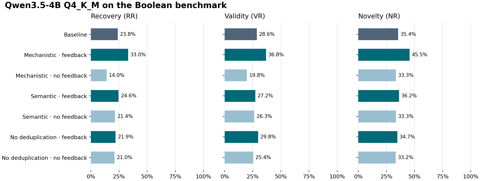

# Qwen3.5-4B Q4_K_M 布尔假设恢复实验

Qwen3.5-4B Q4_K_M 在仓库自带的 56 道布尔题上完成七组实验，共 630 次记录调用。默认 Ours 的机制恢复率为 **33.0%**，Baseline 为 **23.8%**，差值为 **+9.23 个百分点**。本轮 RR 最高的是 **机制去重 · 有反馈（33.0%）**。

## 七组总体结果

VR、NR、RR 都是逐题计算后取均值。VR 衡量候选式是否符合任务约束和观测，NR 衡量假设空间内的机制新颖性，RR 衡量机制真值的恢复比例。NR 包含结构合法但与观测不符的候选，因此可高于 VR。

| 配置 | VR | NR | RR | 对 Baseline 的 RR 差值（百分点） | 调用 | 耗时（秒） |
|---|---:|---:|---:|---:|---:|---:|
| [Baseline](raw/baseline.csv) | 28.6% | 35.4% | 23.8% | +0.00 | 90 | 35.9 |
| [机制去重 · 有反馈](raw/ours_mechanistic.csv) | 36.8% | 45.5% | 33.0% | +9.23 | 90 | 56.1 |
| [机制去重 · 无反馈](raw/ours_mechanistic_no_feedback.csv) | 19.8% | 33.3% | 14.0% | -9.82 | 90 | 39.5 |
| [语义去重 · 有反馈](raw/ours_semantic.csv) | 27.2% | 36.2% | 24.6% | +0.74 | 90 | 50.7 |
| [语义去重 · 无反馈](raw/ours_semantic_no_feedback.csv) | 26.3% | 33.3% | 21.4% | -2.38 | 90 | 37.5 |
| [无去重 · 有反馈](raw/ours_none.csv) | 29.8% | 34.7% | 21.9% | -1.93 | 90 | 48.5 |
| [无去重 · 无反馈](raw/ours_none_no_feedback.csv) | 25.4% | 33.2% | 21.0% | -2.83 | 90 | 37.8 |

## 配对结果与反馈消融

默认 Ours 对 Baseline 的逐题 RR 为 **9 题提高、43 题持平、4 题下降**。在有多个机制真值的 24 道题上，默认 Ours 的 RR 为 31.2%，Baseline 为 30.6%，差值为 +0.69 个百分点。

另有 32 道题每组只调用一次模型，后续历史反馈没有生效机会。该组 Baseline 的 RR 为 18.8%，默认 Ours 为 34.4%，贡献了大部分整体差值。下表在相同去重规则下比较有反馈与无反馈，差值为有反馈减无反馈。

| 去重规则 | 全部题目 RR 差值（百分点） | 多真值题 RR 差值（百分点） |
|---|---:|---:|
| 机制 | +19.05 | +6.94 |
| 语义 | +3.12 | -5.21 |
| 无 | +0.89 | +2.08 |

无去重且无反馈与 Baseline 使用相同的提示与采样规则，两个独立运行的 RR 差值为 -2.83 个百分点。实验只固定了抽题种子，模型生成仍有随机性，各组为单次运行。

## 与 Qwen3.5-9B 的同口径比较

两款模型使用同一份数据、相同的七组配置和逐题调用预算。4B 的七组累计墙钟时间为 306.0 秒，9B 为 484.3 秒。默认 Ours 的 RR 分别为 33.0% 和 38.1%。

| 配置 | 4B RR | 9B RR | 4B − 9B（百分点） | 4B 耗时（秒） | 9B 耗时（秒） |
|---|---:|---:|---:|---:|---:|
| Baseline | 23.8% | 33.9% | -10.12 | 35.9 | 55.9 |
| 机制去重 · 有反馈 | 33.0% | 38.1% | -5.06 | 56.1 | 92.0 |
| 机制去重 · 无反馈 | 14.0% | 29.9% | -15.92 | 39.5 | 62.2 |
| 语义去重 · 有反馈 | 24.6% | 36.2% | -11.61 | 50.7 | 83.1 |
| 语义去重 · 无反馈 | 21.4% | 27.5% | -6.10 | 37.5 | 58.1 |
| 无去重 · 有反馈 | 21.9% | 35.7% | -13.84 | 48.5 | 77.7 |
| 无去重 · 无反馈 | 21.0% | 34.8% | -13.84 | 37.8 | 55.3 |

两轮各组均为单次生成，墙钟时间包含提示处理、生成和逐题写盘。
[跨模型比较 CSV](comparison_with_9b.csv) · [9B 实验报告](../qwen35_9b_q4_k_m_20261126/REPORT.md)

## 实验条件与文件

- M2 Pro，llama.cpp b12359 Metal，Thinking 关闭，上下文 4096，单并发。兼容 macOS 13 的 Metal 缓冲区补丁取自 [llama.cpp PR #29814](https://github.com/ggml-org/llama.cpp/pull/29814)。
- 每组使用同一批 56 道题，抽题种子 42，温度 0.7。每题的调用预算等于该题的机制真值数。仓库自带数据的表达式最多含一个运算符，Simple RR 与 RR 相同，Complex RR 为 n/a。
- [全量汇总](summary.csv)包含各指标、调用数、配对胜平负和耗时。[分层汇总](strata.csv)提供按观测数和真值数量分组的结果。
- [运行配置](manifest.json)记录提交、数据和权重哈希。[运行时长](logs/runs.jsonl)记录每组的退出码与墙钟时间。上表各配置链接到逐题 CSV，其中保留候选式、拒绝记录和模型原始回复。
