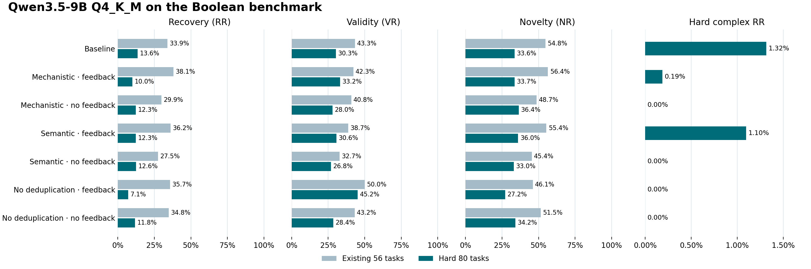

# Qwen3.5-9B 布尔假设恢复实验

Qwen3.5-9B Q4_K_M 在仓库自带的 56 道布尔题上完成七组实验，共 630 次记录调用。默认 Ours 的机制恢复率为 **38.1%**，Baseline 为 **33.9%**，差值为 **+4.17 个百分点**。本轮 RR 最高的是 **机制去重 · 有反馈（38.1%）**。

## 七组总体结果

VR、NR、RR 都是逐题计算后取均值。VR 衡量候选式是否符合任务约束和观测，NR 衡量假设空间内的机制新颖性，RR 衡量机制真值的恢复比例。NR 包含结构合法但与观测不符的候选，因此可高于 VR。

| 配置 | VR | NR | RR | 对 Baseline 的 RR 差值（百分点） | 调用 | 耗时（秒） |
|---|---:|---:|---:|---:|---:|---:|
| [Baseline](raw/baseline.csv) | 43.3% | 54.8% | 33.9% | +0.00 | 90 | 55.9 |
| [机制去重 · 有反馈](raw/ours_mechanistic.csv) | 42.3% | 56.4% | 38.1% | +4.17 | 90 | 92.0 |
| [机制去重 · 无反馈](raw/ours_mechanistic_no_feedback.csv) | 40.8% | 48.7% | 29.9% | -4.02 | 90 | 62.2 |
| [语义去重 · 有反馈](raw/ours_semantic.csv) | 38.7% | 55.4% | 36.2% | +2.23 | 90 | 83.1 |
| [语义去重 · 无反馈](raw/ours_semantic_no_feedback.csv) | 32.7% | 45.4% | 27.5% | -6.40 | 90 | 58.1 |
| [无去重 · 有反馈](raw/ours_none.csv) | 50.0% | 46.1% | 35.7% | +1.79 | 90 | 77.7 |
| [无去重 · 无反馈](raw/ours_none_no_feedback.csv) | 43.2% | 51.5% | 34.8% | +0.89 | 90 | 55.3 |

## 配对结果与反馈消融

默认 Ours 对 Baseline 的逐题 RR 为 **9 题提高、44 题持平、3 题下降**。在有多个机制真值的 24 道题上，默认 Ours 的 RR 为 43.1%，Baseline 为 29.2%，差值为 +13.89 个百分点。

另有 32 道题每组只调用一次模型，后续历史反馈没有生效机会。下表在相同去重规则下比较有反馈与无反馈，差值为有反馈减无反馈。

| 去重规则 | 全部题目 RR 差值（百分点） | 多真值题 RR 差值（百分点） |
|---|---:|---:|
| 机制 | +8.18 | +10.76 |
| 语义 | +8.63 | +3.47 |
| 无 | +0.89 | +2.08 |

无去重且无反馈与 Baseline 使用相同的提示与采样规则，两个独立运行的 RR 差值为 +0.89 个百分点。实验只固定了抽题种子，模型生成仍有随机性，各组为单次运行。

## 实验条件与文件

- M2 Pro，llama.cpp b12359 Metal，Thinking 关闭，上下文 4096，单并发。兼容 macOS 13 的 Metal 缓冲区补丁取自 [llama.cpp PR #29814](https://github.com/ggml-org/llama.cpp/pull/29814)。
- 每组使用同一批 56 道题，抽题种子 42，温度 0.7。每题的调用预算等于该题的机制真值数。仓库自带数据的表达式最多含一个运算符，Simple RR 与 RR 相同，Complex RR 为 n/a。
- [全量汇总](summary.csv)包含各指标、调用数、配对胜平负和耗时。[分层汇总](strata.csv)提供按观测数和真值数量分组的结果。
- [运行配置](manifest.json)记录提交、数据和权重哈希。[运行时长](logs/runs.jsonl)记录每组的退出码与墙钟时间。上表各配置链接到逐题 CSV，其中保留候选式、拒绝记录和模型原始回复。

## 困难题补跑

七组均覆盖[困难题集](../../data/boolean_full_depth2.json)的 80 个观测集，每组计入 975 次调用。每题预算等于机制真值数量。RR、VR、NR 逐题平均。复杂解 RR 在包含 4–5 个运算符真值的 76 题上逐题平均。

| 配置 | 现有 56 题 RR | 困难题 RR | 困难题复杂解 RR | 困难题 VR | 困难题 NR | 困难题 RR 相对 Baseline（百分点） |
|---|---:|---:|---:|---:|---:|---:|
| [Baseline](hard/raw/baseline.csv) | 33.93% | 13.56% | 1.32% | 30.33% | 33.64% | +0.00 |
| [机制去重 · 有反馈](hard/raw/ours_mechanistic.csv) | 38.10% | 10.00% | 0.19% | 33.21% | 33.66% | -3.56 |
| [机制去重 · 无反馈](hard/raw/ours_mechanistic_no_feedback.csv) | 29.91% | 12.28% | 0.00% | 28.03% | 36.42% | -1.28 |
| [语义去重 · 有反馈](hard/raw/ours_semantic.csv) | 36.16% | 12.34% | 1.10% | 30.59% | 36.03% | -1.22 |
| [语义去重 · 无反馈](hard/raw/ours_semantic_no_feedback.csv) | 27.53% | 12.55% | 0.00% | 26.81% | 33.02% | -1.01 |
| [无去重 · 有反馈](hard/raw/ours_none.csv) | 35.71% | 7.07% | 0.00% | 45.22% | 27.22% | -6.49 |
| [无去重 · 无反馈](hard/raw/ours_none_no_feedback.csv) | 34.82% | 11.80% | 0.00% | 28.44% | 34.18% | -1.76 |

- 困难题 RR 最高的是 **Baseline（13.56%）**。复杂解 RR 最高的配置为 Baseline（1.32%）。
- 默认机制去重有反馈的 RR 为 10.00%，相对 Baseline -3.56 个百分点。逐题比较中，18 题提高、35 题持平、27 题下降。复杂解 RR 从 1.32% 变为 0.19%。

| 去重规则 | 有反馈 − 无反馈，困难题 RR（百分点） | 有反馈 − 无反馈，困难题复杂解 RR（百分点） |
|---|---:|---:|
| 机制 | -2.28 | +0.19 |
| 语义 | -0.21 | +1.10 |
| 无 | -4.73 | +0.00 |

本次使用 M2 Pro、llama.cpp b12359 Metal、Thinking 关闭，温度 0.7，每个请求最多 128 个输出 token。题目间使用 16 个并发槽，每槽有效上下文为 1536，同题的反馈轮次顺序执行。按方法、题目和轮次固定生成种子，每组执行一次。达到输出上限的回复有 0 条，按原样计分。56 题历史结果与本次使用的题集、提示版本和推理配置有差异，表中并列提供两轮成绩。

[困难题汇总 CSV](hard/summary.csv) · [按观测数和真值数分层](hard/strata.csv) · [运行配置](hard/manifest.json) · [运行日志](hard/logs/runs.jsonl)
